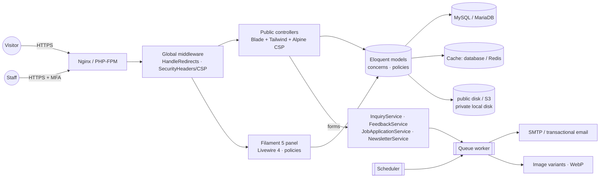

# Architecture

## 1. Overview



- **One Laravel application** serves both the public website and the admin panel (`/admin`).
- **Public site**: server-rendered Blade components; progressive enhancement with Alpine.js (CSP build, no `eval`);
  forms work without JavaScript. GSAP is code-split and only loaded on pages that use parallax/image reveals.
- **Admin**: Filament 5 resources/pages. Every resource has a policy (`strictAuthorization()`); hiding UI is never the
  only control.
- **Content is database-driven**: settings, navigation, page sections, theme, animation presets, email templates.

## 2. Technology choices

| Area | Choice | Why |
|---|---|---|
| Framework | Laravel 13.x | Latest stable; PHP attributes for models (`#[Fillable]`, `#[Scope]`) |
| Admin UI | Filament 5.10 | Same TALL stack (Tailwind/Alpine/Livewire/Laravel) as required; mature tables, forms, MFA, dark mode, policies |
| RBAC | spatie/laravel-permission 8 | Maintained, cache-backed, integrates with Gate |
| Images | intervention/image 4 (GD) | EXIF/GPS stripping, responsive WebP variants |
| SVG uploads | enshrined/svg-sanitize | Removes scripts/remote references from uploaded SVGs |
| Backups | spatie/laravel-backup 10 | Scheduled DB/file backups, health monitoring |
| HTML sanitising | symfony/html-sanitizer (via Filament) | Allow-list sanitizer for rich text |
| CSS | Tailwind CSS 4 (CSS-first `@theme`) + typography plugin | Design tokens mapped to runtime CSS variables |
| JS | Alpine.js 3.17 **CSP build**, @alpinejs/focus, @alpinejs/collapse | Strict Content Security Policy without `unsafe-eval` |
| Motion | IntersectionObserver + CSS; GSAP 3.15 + ScrollTrigger lazy chunk | Small default payload; heavy effects only when needed |
| Fonts | Fontsource variable fonts (Inter, Plus Jakarta Sans) | Self-hosted (no third-party requests), `font-display: swap`, metric-matched fallback |
| Tests | PHPUnit 12, Playwright 1.64 + @axe-core/playwright | Feature/RBAC tests and real-browser accessibility checks |

No React/Vue; one coherent Blade + Alpine architecture.

## 3. Directory structure (application code)

```
app/
  Casts/SanitizedHtml.php           Sanitises rich text on every write
  Console/Commands/                 softec:publish-scheduled, softec:prune-data, softec:purge-demo
  Contracts/HasPublicUrl.php        Content reachable on the website (URLs, visibility, slug paths)
  Enums/                            Statuses, types, SectionType whitelist (Filament label/colour contracts)
  Filament/
    AdminNavigationGroup.php        Sidebar group order
    Actions/ Forms/ Tables/         Shared admin building blocks (MediaPicker, SeoSection, ContentFields, ContentTable…)
    Pages/                          Settings pages, ThemeSettings, SystemHealth, Auth overrides
    Resources/<Module>/             Resource + Pages/ + Schemas/ + Tables/ (+ RelationManagers/)
    Widgets/                        Dashboard widgets (permission-aware)
  Http/
    Controllers/                    Public controllers (thin; render() methods reused by PreviewController)
    Middleware/                     HandleRedirects, SecurityHeaders, AuthenticateAdmin
    Requests/                       PublicFormRequest base (spam checks) + form requests
  Jobs/GenerateMediaVariants.php
  Listeners/                        Auth activity → audit log; email delivery status
  Mail/TemplatedMail.php            Queued, branded, admin-editable email
  Models/ + Models/Concerns/        45 models; HasSlug, Publishable, HasSeo, Auditable, HasRevisions, RecordsSlugRedirects…
  Observers/FlushSiteCache.php      Clears navigation/sitemap caches on content changes
  Policies/                         ModulePolicy base + per-model policies
  Services/                         Form submission services, CRM/blog workflow services, StaffNotifier
  Support/
    Art/CoverArt.php                Procedural brand artwork (SVG)
    Audit/AuditLogger.php           Audit + security events (sensitive values redacted)
    Forms/                          SpamGuard (honeypot, timing, Turnstile), ConsentRecorder
    Html/                           ContentSanitizer, ContentProcessor (TOC, lazy images, safe links)
    Mail/                           EmailTemplateRegistry, renderer, Outbox (email log)
    Media/MediaLibrary.php          Upload pipeline (MIME sniffing, SVG sanitising, EXIF stripping, variants)
    Pages/SectionDataResolver.php   Loads data for page sections; hides empty "verified-only" sections
    Permissions/                    PermissionRegistry (single source of truth), EscalationGuard
    Seo/                            SeoData, SchemaFactory (JSON-LD)
    Settings/                       SettingsRegistry (defaults) + Settings (cached repository)
    Theme/                          ThemeManager, MotionConfig, AdminPalette
config/softec.php                   Infrastructure settings (indexing, media, uploads, spam, retention, reserved slugs)
database/migrations                 9 domain migrations + framework/package tables
database/seeders                    PermissionSeeder, AdminUserSeeder, CoreContentSeeder, DemoContentSeeder,
                                    ContentRefreshSeeder, Concerns/SeedsRichContent (+ data/: services, industries,
                                    insights articles, page SEO)
resources/css/app.css               Design system (tokens, components, motion utilities)
resources/css/filament/admin/       Admin theme
resources/js/                       app.js, components/ (Alpine.data), motion/ (reveals, counters, lazy GSAP)
resources/views/
  components/                       layout, site/*, ui/*, cards/*, forms/*, art/*, media/*, seo/*
  sections/                         One partial per SectionType
  pages/ services/ products/ …      Page templates
  emails/templated.blade.php        Branded email layout
  errors/                           Branded 403/404/410/419/429 + dependency-free 500/503
routes/web.php · routes/assets.php · routes/console.php
tests/Feature (Admin, Public) · tests/Unit · tests/Browser
```

## 4. Key subsystems

### 4.1 CMS pages and sections
`pages` hold page-level content; `page_sections` are ordered, toggleable blocks whose `type` must be a case of
`App\Enums\SectionType` (24 types: hero, stats, logos, services, products, industries, why-choose, tech stack,
case studies, testimonials, process, blog, FAQ, CTA, rich text, image + text, features, values, team, milestones,
certifications, partners, engagement models, scroll statement). Each type maps to `resources/views/sections/<type>.blade.php`.
`SectionDataResolver` loads the records each section needs with eager loading and **drops sections whose verified data
is empty** (e.g. no verified statistics → no stats band). Admins cannot inject markup or scripts through sections.

### 4.2 Settings
`SettingsRegistry` declares every editable setting with defaults (company, contact, social, theme, animation, SEO,
integrations, privacy, forms, features). Values live in the `settings` table, cached forever and flushed on save.
Precedence: stored value → registry default → caller default. **Secrets are never stored in the database**: SMTP,
Turnstile secret, AI key, S3 keys stay in `.env`; the admin only sees "configured / not configured".

### 4.3 Theme system (light/dark, admin-controlled)
- Tailwind tokens (`bg-background`, `text-primary`, …) resolve to CSS variables (`--brand-*`).
- `ThemeManager` renders the active palette as an inline `<style nonce>`; values are validated hex colours, so no CSS
  injection is possible. Contrast warnings (WCAG AA) are shown in the admin.
- Draft vs published theme: admins preview the draft on the live site (session flag, `appearance.manage` required) and
  publish when ready.
- An inline head script applies the visitor's stored choice (light / dark / system) **before first paint** (no flash).
  The admin panel's primary colour follows the published palette (`AdminPalette` keeps the exact brand colour).

### 4.4 Motion system
- Hero headline reveal is pure CSS (never waits for JavaScript).
- Scroll reveals and counters: IntersectionObserver; elements are only hidden after JS confirms motion is allowed.
- GSAP + ScrollTrigger are dynamically imported (separate chunk) only when a page contains `[data-parallax]` or
  `[data-image-reveal]`, motion is enabled and the viewport is not a phone (unless enabled by setting).
- Respects `prefers-reduced-motion`, a visitor "Reduce motion" toggle in the footer, and the admin global switch.
- Admin animation settings are a whitelist of presets (`MotionConfig`); no executable code is accepted.

### 4.5 Media pipeline
`MediaLibrary` sniffs the real MIME type, enforces size/dimension limits, sanitises SVGs, strips EXIF/GPS metadata from
JPEG/PNG, stores files with meaningful slugged names, and queues `GenerateMediaVariants` (480/960/1600 px WebP).
`<x-media.image>` renders `<picture>` with WebP `srcset`, intrinsic width/height (no CLS) and lazy loading.
Private files (inquiry attachments, résumés, pending testimonial photos) live on the non-public `local` disk and are only
served through `FileDownloadController` after a policy check, with audit logging.

### 4.6 Forms and lead handling
`PublicFormRequest` runs `SpamGuard` (honeypot, encrypted render timestamp, optional Turnstile) before validation.
Services persist submissions in a transaction, record consent (`consent_records`, IP stored as keyed hash), collapse
duplicates, store attachments privately, notify permitted staff (database notifications) and configured recipients,
and queue acknowledgement emails through `Outbox` (which writes `email_logs`). Routes are rate limited.

#### Query desk (inquiry routing, teams and queues)
- The contact form asks **what the message is about** (`InquiryTopic`: new project, support, partnership, careers,
  other); project briefs are always *sales*.
- After an inquiry is saved, `InquiryRouter` picks a **team**: an active team handling both the topic and the selected
  service, else one handling the topic, else one linked to the service. Otherwise it stays unrouted, which only
  `inquiries.view_all` users see. Routing runs inside `rescue()`, so a failure can never break the public form.
- Teams with **auto-assign** hand the inquiry to the active member with the fewest open inquiries (ties go to whoever
  was assigned least recently, via `team_user.last_assigned_at`). Otherwise the team's members get a panel notification
  that work is waiting. `InquiryNotifier` emails the assignee (`inquiry_assigned` template) and the team's shared
  mailbox (`inquiry_notification`).
- Members (`inquiries.view_team`) see their teams' inquiries and **pick up** unassigned ones (row-locked claim). Team
  leads (`inquiries.assign`) assign within their team. Managers (`view_all`) see everything, assign anyone eligible and
  move inquiries between teams.
- **Statuses**: New → In progress / Contacted / Qualified / Proposal sent / On hold → Won, Resolved, Lost or Closed
  (`closed_at` is set for the last four). The first move away from *New* records `first_response_at`. Inquiries without
  a first response within `forms.response_target_hours` (default 24, *Settings › Forms*) are **overdue**. This shows in
  the list column, the *Overdue* tab and the *My query desk* dashboard widget.

### 4.7 SEO
`SeoData` builds title/description/canonical/robots/Open Graph/Twitter tags and JSON-LD; per-record overrides come from
the polymorphic `seo_meta` table. Indexing requires **production + `APP_ALLOW_INDEXING=true` + the admin toggle**, so
staging can never be indexed. Dynamic `robots.txt`, sitemap index with one sitemap per content type, managed 301/302/410
redirects (automatic 301 when a published slug changes, chains collapsed). Structured data: Organization, WebSite,
BreadcrumbList, Service, BlogPosting, SoftwareApplication (offers only for real prices), JobPosting (only genuine open
vacancies), LocalBusiness (only when enabled with a full address). No self-serving review/AggregateRating markup.

### 4.8 Authorization
See [PERMISSIONS.md](PERMISSIONS.md). Highlights: `Gate::before` grants Super Administrators all *permission* abilities
while policy guard rails still apply (no self-deletion, last super admin protected); `EscalationGuard` prevents granting
roles/permissions you don't hold; record-level CRM visibility (`visibleTo` scope + policy: assigned, team, all); SEO-only users can open
content forms but all non-SEO fields are disabled and therefore never saved.

### 4.9 Audit trail and revisions
`Auditable` writes create/update/delete events with old/new values (sensitive and long values redacted/truncated).
Authentication events (login, logout, failures with masked email, lockouts, password resets) are security events.
`HasRevisions` keeps up to 30 snapshots for pages, services, products, case studies and blog posts; admins can restore.

## 5. Notable decisions

| Decision | Rationale |
|---|---|
| Filament for the admin instead of hand-built Blade CRUD | 40+ modules with tables, filters, bulk actions, confirmations, MFA and policies — far more robust than custom code; still TALL stack |
| Alpine CSP build on the public site | Enables a nonce-based CSP with `strict-dynamic` and no `unsafe-eval`; the admin (Filament/Livewire) needs a relaxed CSP and is staff-only |
| Small owned lists as JSON (`benefits`, `features`, `process_steps`, `metrics`, section `data`) | Never queried independently; shared entities (technologies, FAQs, industries, media, SEO) are normalised tables |
| Procedural SVG artwork instead of stock photos | No image-generation tool was available in this environment; artwork is original, on-brand, cacheable and replaced automatically when admins upload images |
| Settings key/value table with registry | Avoids dozens of single-row tables; typed defaults in one place |
| Polymorphic `seo_meta`, `media_attachments`, `technologyables`, `faqables` | One reusable implementation across content types |
| Enforced morph map | Stable polymorphic type names in the database |
| Demo content flagged, labelled and purgeable | Lets the design be reviewed without presenting fiction as fact |
