# Database

MySQL 8 / MariaDB 10.6+ (`utf8mb4_unicode_ci`). Tests run on SQLite in-memory; migrations are portable.
Migrations live in `database/migrations` grouped by domain:

| Migration | Tables |
|---|---|
| `0001_01_01_000000_create_users_table` | `users` (+ MFA, activation, last login), `password_reset_tokens`, `sessions` |
| framework/package | `cache`, `jobs`, `failed_jobs`, `job_batches`, `notifications`, Spatie `roles`, `permissions`, `model_has_roles`, `model_has_permissions`, `role_has_permissions` |
| `…100000_create_settings_and_media_tables` | `settings`, `media`, `media_attachments`, `seo_meta` |
| `…100100_create_cms_tables` | `pages`, `page_sections`, `announcements`, `navigation_menus`, `navigation_items`, `redirects` |
| `…100200_create_catalog_tables` | `technologies`, `technologyables`, `service_categories`, `services`, `service_related`, `industries`, `industry_service`, `product_categories`, `products`, `product_plans`, `product_related`, `product_service`, `industry_product` |
| `…100300_create_company_tables` | `clients`, `partners`, `team_members`, `milestones`, `achievements`, `statistics`, `faq_categories`, `faqs`, `faqables` |
| `…100400_create_portfolio_tables` | `portfolio_categories`, `portfolios`, `portfolio_service`, `portfolio_product` |
| `…100500_create_blog_tables` | `authors`, `blog_categories`, `blog_tags`, `blog_posts`, `blog_post_tag`, `blog_comments`, `content_revisions` |
| `…100600_create_engagement_tables` | `testimonials`, `consent_records`, `contact_inquiries`, `inquiry_activities`, `newsletter_subscribers` |
| `…100700_create_careers_tables` | `job_openings`, `job_applications` |
| `…100800_create_system_tables` | `email_templates`, `email_logs`, `audit_logs` |
| `…100900_add_illustration_to_content_tables` | nullable `illustration` (whitelisted name from `IllustrationRegistry`) on `services`, `industries`, `products`, `portfolios` |
| `…101000_create_query_desk_tables` | `teams`, `team_user` (role lead/member, `last_assigned_at` for round-robin), `service_team`; adds `topic`, `team_id`, `first_response_at` to `contact_inquiries` |

## Entity-relationship diagram

Columns are abbreviated to keys and the most important attributes.

```mermaid
erDiagram
    users ||--o| authors : "has profile"
    users ||--o{ contact_inquiries : "assigned_to"
    users ||--o{ inquiry_activities : "acts"
    users ||--o{ audit_logs : "performs"
    users }o--o{ roles : "model_has_roles"
    roles }o--o{ permissions : "role_has_permissions"

    media ||--o{ media_attachments : "galleries"
    media ||--o{ seo_meta : "og_image_id"

    pages ||--o{ page_sections : "ordered blocks"
    navigation_menus ||--o{ navigation_items : "items"
    navigation_items ||--o{ navigation_items : "parent_id"

    service_categories ||--o{ services : "groups"
    services }o--o{ services : "service_related"
    services }o--o{ industries : "industry_service"
    services }o--o{ products : "product_service"
    services }o--o{ portfolios : "portfolio_service"
    product_categories ||--o{ products : "groups"
    products ||--o{ product_plans : "pricing"
    products }o--o{ products : "product_related"
    products }o--o{ industries : "industry_product"
    products }o--o{ portfolios : "portfolio_product"

    industries ||--o{ portfolios : "industry_id"
    industries ||--o{ clients : "industry_id"
    clients ||--o{ portfolios : "client_id"
    portfolio_categories ||--o{ portfolios : "groups"

    technologies ||--o{ technologyables : "tags services/products/portfolios"
    faq_categories ||--o{ faqs : "groups"
    faqs ||--o{ faqables : "attached to services/products/industries"

    authors ||--o{ blog_posts : "writes"
    blog_categories ||--o{ blog_posts : "groups"
    blog_posts }o--o{ blog_tags : "blog_post_tag"
    blog_posts ||--o{ blog_comments : "moderated comments"
    blog_comments ||--o{ blog_comments : "parent_id"

    services ||--o{ testimonials : "service_id"
    teams ||--o{ contact_inquiries : "routed to"
    teams }o--o{ users : "team_user (lead|member)"
    teams }o--o{ services : "service_team"
    contact_inquiries ||--o{ inquiry_activities : "timeline"
    contact_inquiries ||--o{ consent_records : "consentable"
    testimonials ||--o{ consent_records : "consentable"
    job_openings ||--o{ job_applications : "applications"

    users {
        bigint id PK
        string email UK
        bool is_active
        text app_authentication_secret "encrypted"
        timestamp last_login_at
    }
    services {
        bigint id PK
        bigint service_category_id FK
        string slug UK
        string status "draft|published|archived"
        timestamp published_at
        json benefits "owned list"
        bool is_demo
    }
    products {
        bigint id PK
        string slug UK
        string pricing_model
        string availability
        bool is_demo
    }
    blog_posts {
        bigint id PK
        bigint author_id FK
        string status "draft|in_review|scheduled|published|archived"
        timestamp published_at
        longtext body "sanitised HTML"
    }
    testimonials {
        bigint id PK
        text email "encrypted"
        tinyint rating
        bool publish_permission
        bool display_identity_consent
        string status "pending|approved|rejected|archived"
    }
    contact_inquiries {
        bigint id PK
        string reference UK "SAI-YYMM-XXXXXX"
        string topic "sales|support|partnership|careers|other"
        bigint team_id FK
        string status
        string priority
        bigint assigned_to FK
        timestamp first_response_at
        string attachment_path "private disk"
        string ip_hash "HMAC"
    }
    seo_meta {
        bigint id PK
        string seoable_type "morph"
        bigint seoable_id
        string meta_title
        bool robots_index
    }
    settings {
        bigint id PK
        string group
        string key
        json value
    }
    audit_logs {
        bigint id PK
        bigint user_id FK
        string event
        json old_values
        json new_values
        bool is_security_event
    }
```

Polymorphic relations use an **enforced morph map** (`service`, `product`, `blog_post`, …; see `AppServiceProvider`),
so the database never stores PHP class names.

## Important relationships and rules

- **Publishing**: `status` + `published_at`. Public queries use the `published()` scope (status published and date not in
  the future). Blog posts additionally treat `scheduled` posts as live once `published_at` passes, so publication never
  depends on the scheduler; `softec:publish-scheduled` keeps statuses tidy.
- **Slugs** are unique per table (including soft-deleted rows). Changing the slug of live content creates a 301 redirect
  (`redirects.is_automatic = true`) and repoints older redirects to avoid chains.
- **Soft deletes** on primary content (pages, services, products, industries, portfolios, blog posts, job openings,
  testimonials, inquiries, applications) so accidental deletions can be restored; `softec:prune-data` force-deletes
  records past their retention period together with their private files.
- **Deletion policies**: category deletions null the FK on content (`nullOnDelete`); pivots cascade; media references are
  `nullOnDelete` and the media library refuses to delete files that are still referenced.
- **Verified-only data**: `statistics.is_verified`, `achievements.is_verified` (+ expiry), `clients/partners.logo_usage_approved`
  with approval reference, `portfolios.metrics[].is_verified`, `testimonials.publish_permission` + moderation. Unverified
  rows are never rendered publicly.
- **Personal data**: testimonial and comment emails are encrypted at rest; IPs are stored only as keyed HMAC hashes
  (`ip_hash`) except in the staff audit log; email logs store masked recipients; consent decisions are recorded with
  policy version and timestamp.
- **Indexes** cover status/date lookups, ordering columns, CRM filters (`status, created_at`, `assigned_to, status`),
  audit/security queries and polymorphic lookups.

## JSON column policy

JSON is used only for small, owned, ordered lists that are never queried on their own (service benefits/features/process
steps, industry challenges/solutions, product features/benefits, job responsibilities/requirements/benefits, case-study
metrics, plan features, page-section configuration, settings values, revision snapshots, audit diffs, UTM data).
Anything shared or filterable (technologies, FAQs, industries, categories, media, SEO metadata, relationships between
services/products/case studies) is a normalised table with foreign keys.
